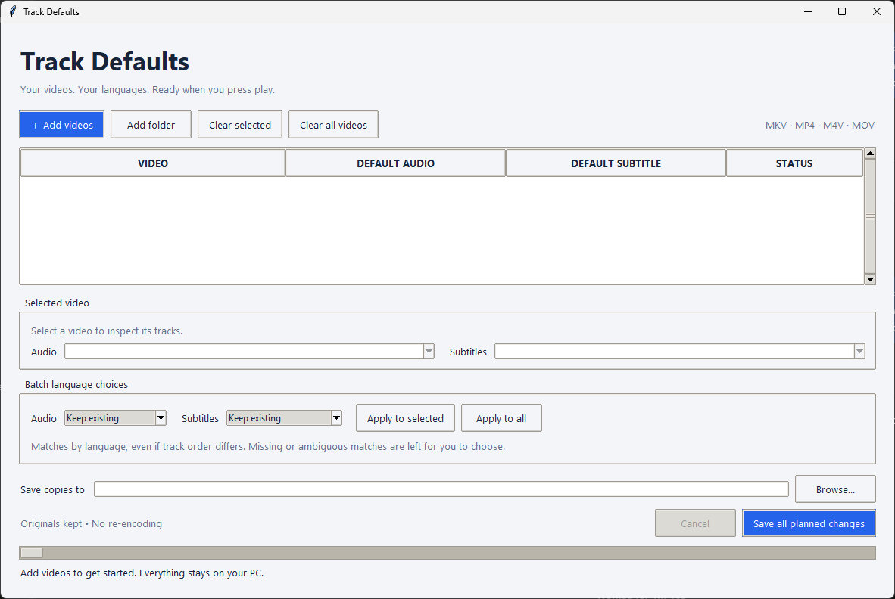

# Track Defaults

**Choose the default audio and subtitle tracks for your videos—in one file or a whole batch.**

Track Defaults is a local Windows desktop app for videos containing multiple audio tracks and subtitles. It lists the embedded tracks and lets you choose which ones a media player should use by default.

For example, you can set Japanese audio and English subtitles for a whole season of a show, even when track order differs between episodes.



## Features

- Inspect track language tags, titles, codecs, audio channel counts, and default/forced flags.
- Choose audio and subtitle defaults independently for each video.
- Apply language choices to selected videos or every video in a batch.
- Review missing or ambiguous language matches instead of guessing.
- Keep all tracks and save new copies without overwriting originals.
- Copy video and audio without re-encoding.
- Process everything locally; videos are not uploaded.

## Download and open

For **64-bit Windows 10 or Windows 11**:

1. Open this repository's **Releases** section.
2. Download **Track Defaults-Windows-x64.zip** from the release assets, when available. GitHub's automatic **Source code** ZIP does not contain the ready-to-run app.
3. Extract the ZIP to a folder on your PC.
4. Double-click **Track Defaults.exe**.

Python and the video tools are included. No installer, separate Python installation, or administrator access is needed. The first launch can take a few seconds while the tools unpack. The current executable is unsigned.

## How to use it

1. Click **Add videos** to select files, or **Add folder** to include videos directly inside a folder. Subfolders are not scanned.
2. Select a video in the list to inspect its audio and subtitle tracks.
3. Choose defaults individually, or use **Batch language choices** and click **Apply to selected** or **Apply to all**.
4. Resolve files marked **Needs review** by choosing their tracks manually.
5. Check the **Save copies to** folder.
6. Click **Save all planned changes**.

You can queue many videos at once. They are saved one at a time to avoid competing for disk bandwidth. **Cancel** stops the current operation while keeping completed copies.

### Where are copies saved?

By default, copies go into a **Track Defaults** subfolder beside the first video you add. Use **Browse…** beside **Save copies to** to change this.

```text
Videos/
├── Episode 01.mkv
├── Episode 02.mkv
└── Track Defaults/
    ├── Episode 01.defaults.mkv
    └── Episode 02.defaults.mkv
```

If a name already exists, a number is added, such as `Episode 01.defaults (2).mkv`. Saving copies requires roughly the same free disk space as the originals.

## Supported files

| Container | Extensions |
| --- | --- |
| Matroska | `.mkv` |
| MPEG-4 | `.mp4`, `.m4v` |
| QuickTime | `.mov` |

MKV is the most dependable choice for default-track behavior. Some container/track combinations may not retain the requested defaults. The app verifies track counts, codec types, and explicitly requested defaults before publishing each completed copy. Failures are reported without changing the source.

## Things to know

- **Players have their own preferences.** Preferred-language settings can override defaults stored in a file.
- **Languages come from embedded tags.** The app does not listen to audio or translate subtitles. Untagged tracks appear as **Unspecified**.
- **Duplicate languages require review.** Two English audio tracks will not be guessed between. Missing or ambiguous batch matches reset that category to **Keep existing** and mark the file **Needs review**.
- **No default subtitle does not remove subtitles.** It clears the default flag while preserving forced flags. Forced subtitles may still display.
- **Keep existing** makes no explicit default changes for that category.
- **The container is rewritten.** Streams are copied without re-encoding, with metadata and chapters copied where supported. Container-specific metadata may be normalized; outputs are not byte-identical archives.

## Run from source

Requirements: Windows, Python 3.12 with Tkinter, and FFmpeg/FFprobe. The app itself uses Python's standard library.

In the project folder:

```powershell
python setup_tools.py
python app.py
```

The setup script downloads the Windows FFmpeg essentials build from Gyan and verifies its published SHA-256 checksum. It needs internet access; normal processing does not. Tools are stored in `tools`. Alternatively, make `ffmpeg` and `ffprobe` available on your PATH.

With Python installed, you can also double-click **Track Defaults.vbs**.

## Build a Windows executable

Use 64-bit Python 3.12 on Windows:

```powershell
python -m venv .build-env
.\.build-env\Scripts\python.exe -m pip install -r requirements-build.txt
.\.build-env\Scripts\python.exe setup_tools.py
.\.build-env\Scripts\python.exe build_release.py
```

Outputs in `release`:

- `Track Defaults.exe` — portable executable with bundled tools.
- `Track Defaults-Windows-x64.zip` — sharing package with instructions, notices, and app source.
- `SHA256.json` — checksums for the executable and ZIP.

## Tests

```powershell
python -m unittest discover -s tests -v
```

Integration tests generate sample videos and check default changes, track preservation, cancellation, and output-name collisions. Install the video tools first; otherwise integration tests are skipped.

To test the packaged executable:

```powershell
Start-Process -FilePath '.\release\Track Defaults.exe' -ArgumentList '--self-test', 'release/package-check.json' -Wait
Get-Content '.\release\package-check.json'
```

This checks the bundled tools, a real video save, output defaults, and desktop UI startup.

## Reporting a problem

Open an issue with your Windows version, video container, chosen tracks, and error text. You do not need to upload your video.

## Third-party tools

Uses [FFmpeg](https://ffmpeg.org/) and [FFprobe](https://ffmpeg.org/ffprobe.html), with Windows binaries from [Gyan's builds](https://www.gyan.dev/ffmpeg/builds/). Portable packages also include Python and Tcl/Tk; included license notices are in the package's `licenses` folder.

Generated binaries, downloaded tools, and local environments are excluded from the source repository. Distributable packages belong in GitHub Releases.

## License

Track Defaults code and documentation are licensed under the [MIT License](LICENSE), copyright (c) 2026 nordicw0lf. You may use, modify, and redistribute them, including commercially, subject to the license terms.

Bundled FFmpeg/FFprobe, Python, and Tcl/Tk retain their respective licenses. The current FFmpeg build uses GPLv3 components. See [third-party notices and binary release requirements](THIRD_PARTY_NOTICES.md), including the outstanding review of corresponding-source availability for distributed FFmpeg binaries.
